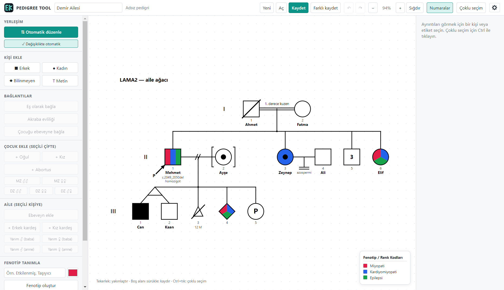
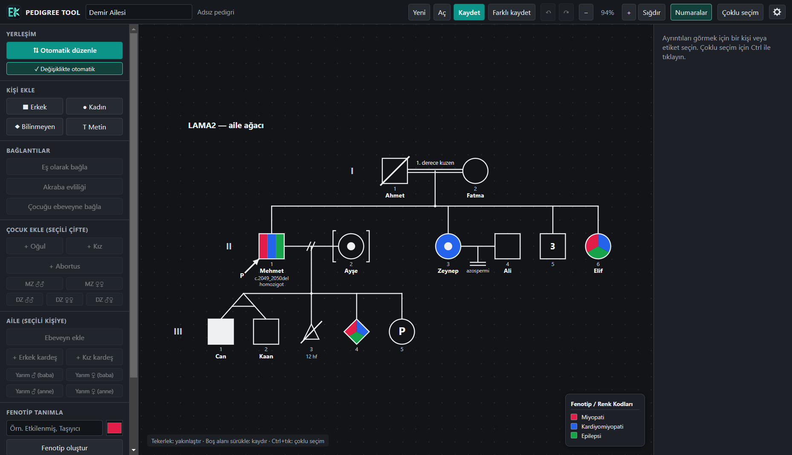
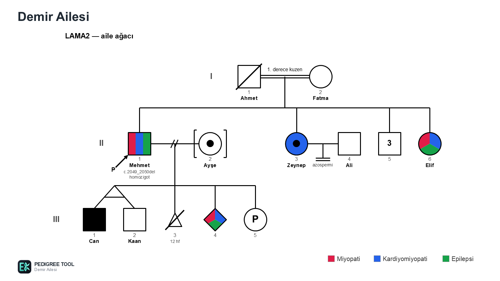

# Pedigree Tool

A desktop application for drawing pedigrees (family trees) for genetic counselling,
teaching and research. Symbols follow the standard pedigree nomenclature (NSGC), and a
drawing can be exported as a fully editable PowerPoint slide.

Genetik danışmanlık, eğitim ve araştırma için pedigri (soy ağacı) çizim aracı.
*Türkçe açıklama aşağıdadır.*



## Features

- **Standard symbols:** affected, carrier, deceased, proband, pregnancy, stillbirth,
  adoption, miscarriage / termination / ectopic, monozygotic and dizygotic twins,
  consanguinity, divorce, childlessness / infertility, and grouped symbols ("5", "n").
- **Automatic layout:** generations sit on rows, partners side by side, children centred
  under their parents. With "auto-arrange on changes" every edit is tidied in the same
  undo step.
- **Phenotypes with colour codes:** a symbol is split into equal parts for two, three or
  more phenotypes, with a legend.
- **Editable PowerPoint export:** every symbol, line and label is a native PowerPoint
  object, so the slide can be adjusted afterwards.
- **Light and dark theme**, Turkish and English interface.
- **Fully local:** no internet connection, no data leaves the computer. Drawings are saved
  as plain JSON files.

| Dark theme | PowerPoint export |
|---|---|
|  |  |

## Download and run (Windows)

1. Download `Pedigree Tool-<version>-win.zip` from the
   [Releases](https://github.com/erenkilinc1869/pedigree-tool/releases) page.
2. Extract the zip anywhere and double-click `Pedigree Tool.exe`. There is no installer.

On first start the program shows a short information screen and can create desktop and
Start-menu shortcuts.

## Run from source

Requires [Node.js](https://nodejs.org) 18 or later.

```bash
npm install
npm start      # run the app
npm test       # unit tests
npm run dist   # build the Windows package into release/
```

There is no build step for the app itself: plain scripts loaded from `app/index.html`,
with React and PptxGenJS vendored in `app/vendor/`. Developer notes (in Turkish) are in
[docs/GELISTIRME.md](docs/GELISTIRME.md).

## Important

Pedigree Tool is **not a medical device** and must not be used on its own to make a
diagnosis or a clinical decision. Drawings should be checked by a qualified professional.
You are responsible for handling patient information in line with applicable data
protection law (for example KVKK or the GDPR); using anonymous codes instead of names is
recommended.

## How to cite

If you use Pedigree Tool in your work, please cite it. Citation details are in
[CITATION.cff](CITATION.cff) (on GitHub: "Cite this repository" in the sidebar).

## Authors

Designed and developed by **Eren Kılınç**, with contributions from the resident
physicians of the Department of Medical Genetics, Erciyes University.

## Licence

Copyright (c) 2026 Eren Kılınç.

Pedigree Tool is free software, licensed under the GNU General Public License version 3
or (at your option) any later version. See [LICENSE](LICENSE). It is distributed without
any warranty. Third-party components (Electron, React, PptxGenJS; MIT) are listed in
[THIRD-PARTY-NOTICES.txt](THIRD-PARTY-NOTICES.txt).

---

## Türkçe

Pedigree Tool; genetik danışmanlık, eğitim ve araştırma amacıyla pedigri çizmek için
geliştirilmiş bir masaüstü uygulamasıdır. Semboller uluslararası standart pedigri
gösterimine (NSGC) göre çizilir; çizim, her öğesi düzenlenebilir bir PowerPoint slaytı
olarak dışa aktarılabilir.

- **Kullanım:** [Releases](https://github.com/erenkilinc1869/pedigree-tool/releases)
  sayfasından zip dosyasını indirin, bir klasöre açın ve `Pedigree Tool.exe`'ye çift
  tıklayın. Kurulum gerekmez.
- **Özellikler:** otomatik yerleşim, fenotip renk kodları ve lejant, ikiz / akraba
  evliliği / boşanma / çocuksuzluk gösterimleri, açık ve koyu tema, Türkçe ve İngilizce
  arayüz.
- **Gizlilik:** uygulama tamamen bilgisayarınızda çalışır; internet bağlantısı kurmaz ve
  hiçbir veriyi dışarı göndermez.
- **Uyarı:** tıbbi cihaz değildir; tanı koymak ya da klinik karar vermek için tek başına
  kullanılamaz. Hasta verilerinin KVKK'ya uygun işlenmesinden kullanıcı sorumludur.
- **Yazar:** Erciyes Üniversitesi Tıbbi Genetik Anabilim Dalı asistan doktorlarının
  katkılarıyla Eren Kılınç tarafından tasarlanmış ve geliştirilmiştir.
- **Lisans:** GNU Genel Kamu Lisansı sürüm 3 ya da sonrası (GPL-3.0-or-later).
- **Geliştirici notları:** [docs/GELISTIRME.md](docs/GELISTIRME.md)
